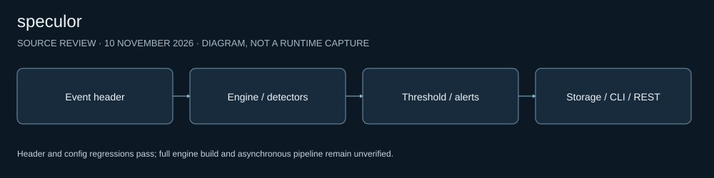
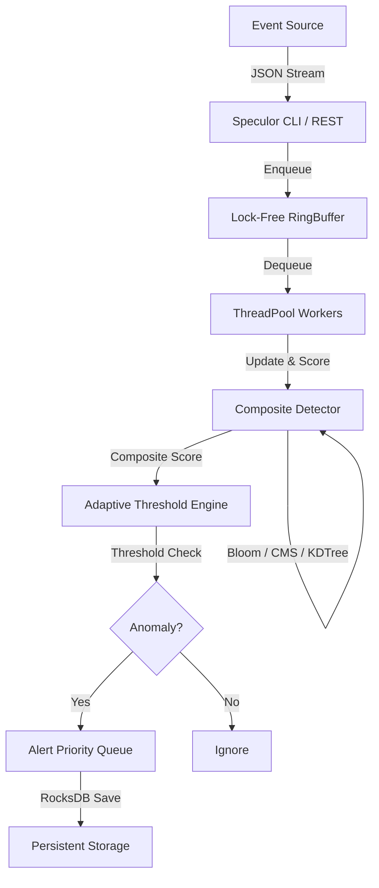

# Speculor

## Verified scope — 10 November 2026

This is a C++ anomaly-engine prototype, with Bloom/CMS/KD-tree detector sources,
an adaptive threshold, CLI/REST entry points and RocksDB persistence code. The
full application is **not build-verified**. The independent public Event header
regression compiles and runs with GCC C++17; repeated inclusion previously
redefined `speculor::Event`, now prevented by an include guard.

Run the independent check without downloading dependencies:

```sh
g++ -std=c++17 -Wall -Wextra -pedantic -I include tests/unit/test_event_header.cpp -o event-header-test
./event-header-test
```

The CMake test block also registers this check as `speculor_event_header_test`.
Full configuration in the review environment stops at missing `spdlog`. Configuration parsing/serialization now uses typed YAML/JSON defaults and
round-trips detector maps, plugins, booleans and numeric values. A standalone
regression against yaml-cpp 0.8.0 / nlohmann JSON 3.11.3 covers defaults, custom
values (including zero/false), both serializations and malformed input. CMake now
links these dependencies, the vcpkg manifest includes YAML and the default REST
feature, and Docker copies the default-enabled tests. These targeted repairs do
not establish a complete engine build.
`process_async` queues events but schedules work on captured copies without
draining that queue, so the architecture below is an intended design rather than
a measured throughput or concurrency guarantee.



The diagram is based on source inspection. No throughput benchmark, complete
pipeline execution, Docker build or persistence recovery was run in this review.
The existing license and project history are retained.


**Speculor** is a C++ streaming anomaly detection prototype for event analytics. It features a multi-algorithm composite detection pipeline integrated with a dynamic, adaptive threshold alerting system.

---

## Key Features

- **Composite Detector Pipeline**: Aggregates scores from multiple detection algorithms:
  - **Counting Bloom Filter**: Estimates pattern rarity using space-efficient hashing.
  - **Count-Min Sketch**: Estimates statistical frequency of events.
  - **Multi-Dimensional KD-Tree**: Computes spatial nearest-neighbor distances for anomaly scoring.
- **Adaptive Threshold Engine**: Learns thresholds dynamically using:
  - **Exponential Moving Average (EMA)**: Follows the variance of anomaly scores.
  - **Threshold Optimizer**: Performs dynamic programming on a sliding window to maximize F1-score.
- **Concurrency Infrastructure**:
  - **SPMC Ring Buffer**: Lock-free single-producer multi-consumer queue for high-throughput ingestion.
  - **ThreadPool**: Work-stealing queue for background processing of event batches.
  - **Task Scheduler**: Deferable periodic execution engine for maintenance tasks (e.g., snapshots, decay cycles).
- **Persistence Layer**: Built-in state snapshots and recovery using **RocksDB**.
- **Cross-Platform Plugin System**: Platform-agnostic plugin loader supporting Windows DLLs (`LoadLibraryA`) and Linux shared libraries (`dlopen`).
- **REST Server & CLI**: Out-of-the-box binaries for pipeline orchestration.

---

## Architecture Flow



---

## Directory Structure

```text
speculor/
├── CMakeLists.txt             # CMake Build Configuration
├── vcpkg.json                 # Dependency Management
├── config.yaml                # Sample Configuration
├── events.jsonl               # Test Event Stream
├── include/speculor/          # Public Headers
│   ├── core/                  # Engine, Event, Alert definitions
│   ├── detectors/             # Bloom, CMS, KD-Tree, Composite
│   ├── concurrency/           # RingBuffer, ThreadPool, Scheduler
│   ├── storage/               # RocksDB integration, Compressor, Serializer
│   └── plugin/                # Plugin Base & Loader
└── src/                       # Implementation files
```

---

## Build Instructions

### Prerequisites
Ensure you have the following installed:
- **CMake** (v3.20+)
- **Ninja** or another compatible build tool
- A C++17 compatible compiler (e.g., GCC 9+, MSVC 2019+, Clang 10+)
- **vcpkg** package manager

### Step 1: Bootstrap Dependencies via vcpkg
If you do not have a global `vcpkg` installation, clone and bootstrap a local instance:
```powershell
git clone https://github.com/microsoft/vcpkg.git C:\vcpkg
C:\vcpkg\bootstrap-vcpkg.bat
```

### Step 2: Configure and Build
Configure CMake by pointing to the `vcpkg.cmake` toolchain file:
```powershell
cmake -B build -S . -DCMAKE_TOOLCHAIN_FILE="C:/vcpkg/scripts/buildsystems/vcpkg.cmake"
cmake --build build --config Release
```

> **Note:** the default configure builds the core library, tests, CLI and REST
> server. The optional `SPECULOR_BUILD_BENCHMARKS` and `SPECULOR_BUILD_EXAMPLES`
> targets are both `OFF` by default, and the `benchmarks/` and `examples/`
> source files they reference are not present in this repository. Enabling
> either option with `-DSPECULOR_BUILD_BENCHMARKS=ON` or
> `-DSPECULOR_BUILD_EXAMPLES=ON` will fail at configure time until those
> directories are added.

---

## Getting Started

### 1. Run via CLI
Stream events from a JSONL file through the CLI and view real-time alerts:
```powershell
./build/speculor -c config.yaml -i events.jsonl
```

Or stream events directly from standard input:
```powershell
echo '{"metric_name": "cpu_usage", "value": 95.8}' | ./build/speculor -c config.yaml
```

### 2. Run REST Server
Start the HTTP REST API server (listening on port `8080` by default):
```powershell
./build/speculor_rest 8080
```

#### Push an Event
```bash
curl -X POST http://localhost:8080/event \
  -H "Content-Type: application/json" \
  -d '{"metric_name": "network_tx", "value": 850000.0, "labels": {"env": "prod"}}'
```

#### Retrieve Recent Alerts
```bash
curl http://localhost:8080/alerts
```

---

## 🐳 Docker Deployment

### Running with Docker Compose
You can run the Speculor anomaly detection REST server in a containerized environment (built using a multi-stage Dockerfile with vcpkg and Ninja):

1. **Build and start the container**:
   ```bash
   docker compose up -d --build
   ```
2. **Access the REST server**:
   The server listens on port `8080`. Push events and query alerts as described in the Getting Started section above.

Persistent state snapshots are saved in the RocksDB database, which is mounted and persisted on the host machine using a named volume (`speculor-data`).

